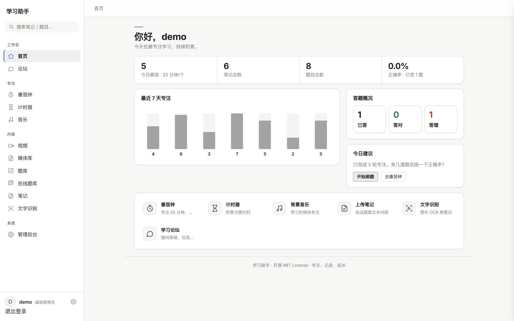
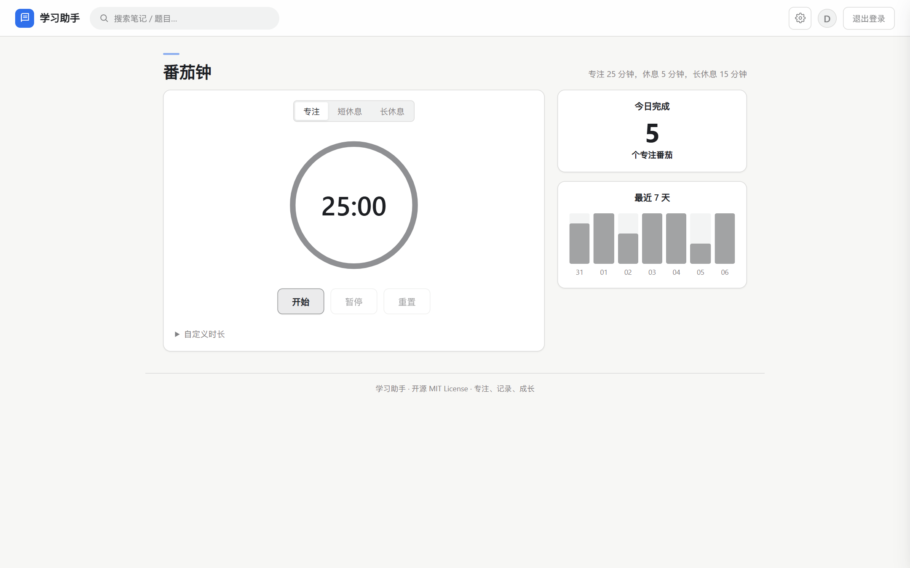
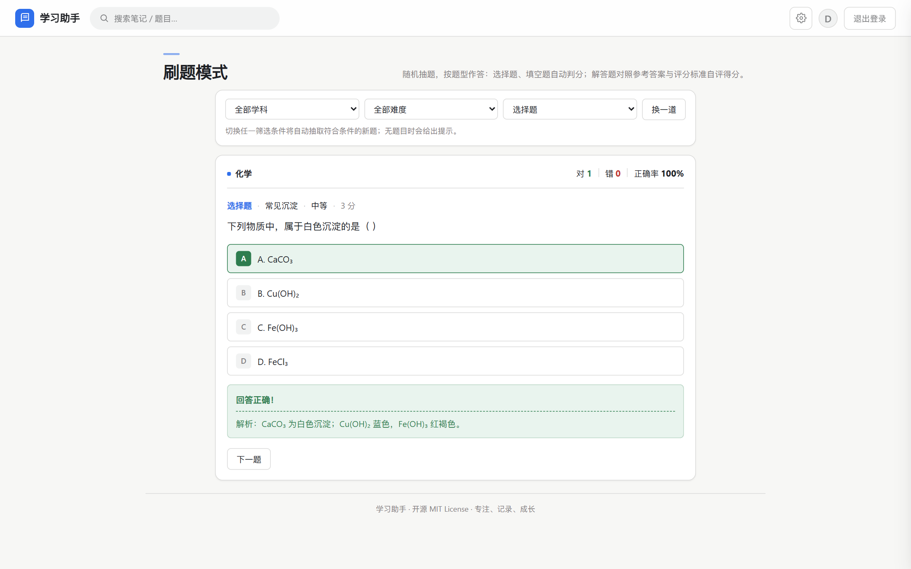
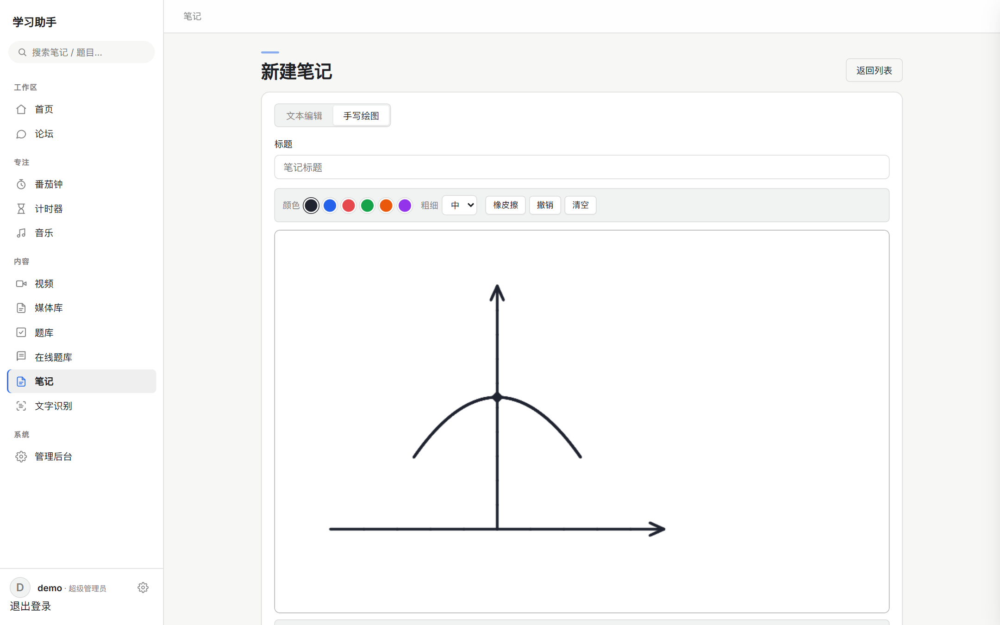
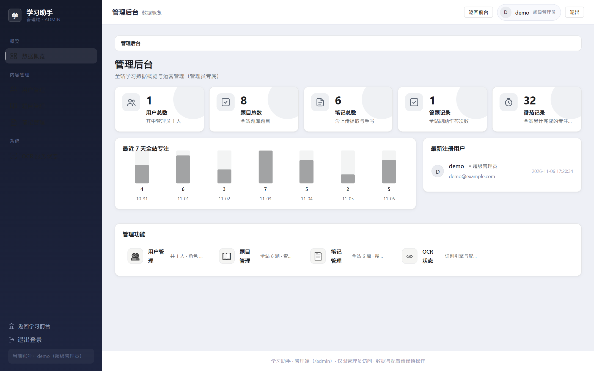

# 学习助手 (Study Assistant)

一个开源的「个人学习助手」Web 应用，帮助你在学习过程中保持专注、整理笔记、刷题复盘、沉淀资料。

后端 Flask + SQLite，前端原生 HTML/CSS/JS（零 CDN 依赖），一条命令即可在本地跑起来。

> **两种使用方式（v1.1.0 起）**
> - **免安装 · 单机桌面版（推荐普通用户）**：到 [Releases](https://github.com/Pzt1212/study-assistant/releases) 下载 `学习助手-单机版.zip`，解压后双击 `学习助手.exe`，自动打开浏览器即用。**不用装 Python、不用联网、不用登录**。详见 [单机桌面版](#单机桌面版免安装-exe)。
> - **源码版（开发者 / 多用户）**：`Download ZIP` 只包含源代码，需要 Python 3.8+；按下方 [安装步骤](#安装步骤) 配置，或在 Windows 上双击 `scripts\start.vbs` 后台启动后访问 `http://127.0.0.1:5000`。
>
> 两个版本共用同一套代码：单机版是源码版的 PyInstaller 打包产物，功能一致，区别只是把「注册 / 登录 / 多用户」换成了单人自动登录。

## 界面预览

| 仪表盘 | 番茄钟 |
|---|---|
|  |  |

| 刷题（即时判分） | 笔记手写 |
|---|---|
|  |  |



> 以上截图来自项目本地运行效果。首次使用请先注册账号；需要进入管理后台时，用 `python tools/create_admin.py` 把该账号提升为管理员。
>
> 注：截图拍摄于 v1.0.x 界面。**v1.1.0 起仪表盘已改为「独立功能按钮网格」布局**（去掉分组侧边栏，顶栏控件拆成独立按钮），其余页面与截图一致。

## 功能列表

| 功能 | 说明 |
|------|------|
| 用户系统 | 注册 / 登录 / 退出，bcrypt 密码加密，Flask-Login 会话管理；四层角色（普通 / 协管 / 管理员 / 超级管理员） |
| 仪表盘 | 今日专注、笔记与题目数量、最近动态、七日专注曲线 |
| 管理后台 | 独立管理端界面（`/admin`）：数据概览 / 用户管理 / 全站题目 / 全站笔记 / OCR 状态 |
| 番茄钟 | 专注 25 分钟 / 短休息 5 分钟 / 长休息 15 分钟，时长可自定义；每日完成数统计 |
| 计时器 | 秒表（正计时）与倒计时，结束有提示音 |
| 背景音乐 | 播放 / 暂停 / 上一首 / 下一首 / 音量调节 / 循环模式。曲目分「在线轻音乐」与「脑波音频」两类：后者由浏览器本地合成、离线可用 |
| 题库 | 题目增删改查、按学科/主题/题型/难度筛选；刷题模式支持按「学科 × 难度 × 题型」组合筛选随机抽题（选择题/填空题/解答题即时判分 + 解析 + 自评）。**题目需自行准备**：可手动录入、批量导入，或通过「在线题库」接入自备 API |
| 在线题库 | **自带 API**：项目不内置任何题目与令牌，填写自己的「一题一答」接口地址和令牌，即可批量查询答案并导入个人题库 |
| 笔记 | 上传文件（txt、md、图片）自动提取文本、**文本/手写双模式编辑器**（Canvas 手写支持颜色/粗细/橡皮擦/撤销/清空，保存为 SVG 内嵌存储）、在线编辑、删除、全文搜索 |
| 文字识别 (OCR) | 上传图片 → **选择「印刷体 / 手写体」** → 识别文字 → 预览/编辑 → 保存为笔记。印刷体默认走本地 Tesseract（支持 `bin/tesseract/` 内置打包，也可切换 OCR.space / 百度在线引擎）；手写体优先本地插件 rapidocr-onnxruntime，缺失时友好降级提示 |
| 视频 | 本地视频库（`/video`）：列出 `video/downloads/` 下已下载的视频，提供封面抽帧、断点播放与文件下载 |
| 媒体库 | 视频/音频上传与播放（`/media`，见 `docs/media-direct-transfer.md`）：无公网 IP 时用 **Cloudflare R2 直连分块传输**绕过 Tunnel 绕路问题——浏览器分块直传 R2（预签名 multipart，断点续传）、私有桶预签名 Range 播放（防盗链）、异步 SHA-256 审计 + 桶级备份；设备自适应；内置线程队列异步任务（Windows 免 Redis），可选 Celery。依赖 `pip install -r requirements-media.txt`。**纯本地使用无需配置 R2**，不配置时该页面不可用，其余功能不受影响 |
| 论坛 | 发帖 / 回帖 / 删除（`/forum`）；管理员可删除任意帖子与回复。**完全内置，数据存本地 SQLite，不依赖任何外部服务** |
| 全局搜索 | 搜索笔记标题/内容、题目题干/解析/科目，结果分组展示 |
| 运行管理 | 一键后台启动 / 停止 / 状态查看（`manage.py` 与配套脚本），管理员账户工具，健康检查接口 |
| 内网穿透 | Cloudflare Tunnel 免费方案：`scripts\tunnel_start.bat` 一键启动（Quick 隧道免登录，分配 `*.trycloudflare.com` 临时公网地址）；支持自定义域名命名隧道（详见 `docs/TUNNEL.md`） |
| 单机桌面版 | **v1.1.0 新增**：Windows 免安装绿色版，双击 `学习助手.exe` 自动开浏览器即用，单人免登录，内置中文 OCR，数据全留本机（详见下方章节） |

## 单机桌面版（免安装 exe）

> v1.1.0 新增。适合只想「双击就用」、不想配环境的 Windows 用户。

**下载**：前往 [GitHub Releases](https://github.com/Pzt1212/study-assistant/releases) 下载 `学习助手-单机版.zip`（约 227 MB，已内置简体中文 OCR 引擎），解压到任意文件夹即可。

**使用**：

1. 双击文件夹里的 `学习助手.exe`；
2. 程序自动启动本地服务并打开浏览器访问 `http://127.0.0.1:5000`（没自动弹出就手动打开该地址）；
3. **单人模式已自动登录**，打开即是你的工作台，无需账号密码；
4. 关闭黑色控制台窗口（或按 `Ctrl+C`）即退出。

| 特性 | 说明 |
|------|------|
| 免环境 | 不需要 Python、不需要装依赖、不需要装 Tesseract；内置印刷体中英文 OCR |
| 免登录 | 首次启动自动创建管理员账号（默认用户名 `user`，随机 6 位密码写入 `data/账号信息.txt`），之后自动登录；注册入口已禁用以保持单用户 |
| 绿色便携 | 数据库、上传文件、日志、媒体全部落在 exe 旁目录；备份 = 复制整个文件夹，卸载 = 删除整个文件夹 |
| 离线可用 | 除「在线轻音乐 / 在线题库 / 媒体库（R2）」等需外部服务的功能外，全部功能本机运行、不外发数据 |
| 不打架 | 已在运行时再次双击只会打开浏览器，不会启动第二个实例；5000 端口被别的程序占用时自动改用 5001+ |

目录结构（解压后）：

```
学习助手单机版/
├── 学习助手.exe          # 双击启动
├── 使用说明.txt          # 随包说明
├── _internal/            # 运行时依赖（请勿删除）
├── data/                 # 数据库 + 账号信息.txt + 媒体存储
├── uploads/              # 上传文件
└── logs/                 # 运行日志
```

重置数据 / 账号：退出程序后删除 `data/`，下次启动会重新初始化。
自定义账号：启动前设置环境变量 `STANDALONE_USERNAME` / `STANDALONE_PASSWORD`。

**与源码版的区别**：单机版为单人使用（禁用注册）；媒体库等需外部云配置的功能默认不可用；其余功能一致。

<details>
<summary>从源码自行打包（开发者）</summary>

依赖：Windows + Python 3.9~3.14、`pip install pyinstaller`、`pip install -r requirements.txt`。
若要内置中文 OCR，先执行 `python tools/setup_tesseract.py` 生成 `bin/tesseract/`
（该目录体积大，被 `.gitignore` 忽略，不在仓库里；也可以从 `packaging/standalone.spec` 的 `datas` 中移除）。

```bash
# 在项目根目录执行
python -m PyInstaller --noconfirm --distpath dist/exe-dist --workpath build-exe packaging/standalone.spec
```

产物在 `dist/exe-dist/学习助手/`（`学习助手.exe` + `_internal/`）。把该目录复制成一个新的发布文件夹，
放入 `packaging/使用说明.txt`，再压缩成 zip 即可分发。

注意事项：

- **发布前必须确认文件夹里没有 `data/`、`logs/`、`uploads/`**——这些是本机运行后才生成的，
  含个人数据库与 `账号信息.txt`，绝不能随包发布；
- zip 约 227 MB，**不要提交进 git**（GitHub 单文件上限 100 MB），应上传到 Release 资产；
- `onedir` 模式下 `_internal/` 与 exe 必须保持同级，不能只单独拷贝 exe。

</details>

## 环境要求

- Python 3.8+（已在 Windows + Python 3.9 上验证）
- pip（Python 包管理器）

### 可选依赖

- **OCR 印刷体**：默认使用本地 Tesseract。**推荐把引擎放入项目 `bin/tesseract/` 目录开箱即用**
  （联网时执行 `python tools/setup_tesseract.py` 自动下载内置版本 + 简体中文语言包）；
  也可系统安装后由代码自动发现：
  - Windows 下载：[UB-Mannheim/tesseract](https://github.com/UB-Mannheim/tesseract/wiki)（安装时勾选中文语言包）
  - macOS：`brew install tesseract tesseract-lang`
  - Linux：`sudo apt install tesseract-ocr tesseract-ocr-chi-sim`
- **OCR 手写体（可选插件）**：`pip install -r requirements-handwriting.txt`
  （rapidocr-onnxruntime，离线识别手写/印刷中英文，无需 API Key；未安装时自动降级并友好提示）
- **媒体库（可选）**：`pip install -r requirements-media.txt`
  （boto3 + cryptography；未安装时媒体库页会提示缺少依赖）

## 安装步骤

```bash
# 1. 克隆仓库
git clone https://github.com/Pzt1212/study-assistant.git
cd study-assistant

# 2. 创建虚拟环境（推荐）
python -m venv venv
# Windows
venv\Scripts\activate
# macOS / Linux
source venv/bin/activate

# 3. 安装依赖
pip install -r requirements.txt

# 4. 初始化数据库并启动
python manage.py start        # 后台启动（日志 logs/app.log）
# 或前台调试：
python app.py
```

浏览器访问 `http://127.0.0.1:5000` 即可使用。

## 启动与停止（Windows）

**日常只需要记住两个东西：双击 `scripts\start.vbs` 启动，双击 `scripts\stop.bat` 停止。**

| 入口 | 作用 |
|------|------|
| `scripts\start.vbs` | 静默后台启动，不弹任何窗口（推荐） |
| `scripts\start.bat` | 后台启动，并显示启动提示与健康检查结果 |
| `scripts\stop.bat` | 停止服务 |
| `python manage.py …` | 命令行统一管理：`start` / `stop` / `status` / `restart` / `log` |

```bash
python manage.py start      # 后台启动
python manage.py stop       # 停止
python manage.py status     # 状态 + 健康检查
python manage.py log 80     # 查看最近 80 行日志
```

监听地址/端口可用环境变量 `APP_HOST` / `APP_PORT` 覆盖（默认 `127.0.0.1:5000`）。
所有入口的日志都在 `logs/app.log`，PID 在 `logs/app.pid`。

> **历史脚本**：`scripts\start_silent.vbs`、`scripts\start_server.bat` / `scripts\stop_server.bat` / `scripts\status_server.bat`
> 是早期版本留下的等价入口（后者日志写在 `logs/server.log`）。保留仅为兼容，新用户不必使用。

## 创建管理员账户

```bash
python tools/create_admin.py                      # 默认用户名 admin，随机强密码（只打印一次）
python tools/create_admin.py --username boss --password 你的密码
```

登录后访问 `http://127.0.0.1:5000/admin` 进入后台管理。

## 各功能使用方法

### 1. 注册与登录
- 打开首页，点击「注册」创建账号（用户名、邮箱、密码）。
- 注册成功后，用用户名或邮箱登录。
- 登录后右上角显示当前用户名，点击「退出」可退出登录。

### 2. 番茄钟
- 在导航栏点击「番茄钟」进入。
- 切换专注 / 短休息 / 长休息模式，点击「开始」计时。
- 倒计时结束后自动播放提示音，专注完成自动记录到「今日完成」统计。
- 点开「自定义时长」可修改各模式分钟数。

### 3. 计时器
- 在导航栏点击「计时器」进入。
- 秒表：点击「开始」正计时，可暂停/继续/清零。
- 倒计时：设置分钟数后点击「开始」，结束后播放提示音。

### 4. 背景音乐
- 在导航栏点击「音乐」进入。
- 播放/暂停、上一首/下一首、音量调节、循环模式切换（不循环/列表循环/单曲循环）。
- 曲目有两个**互不相同**的来源：
  - **脑波音频**：浏览器用 Web Audio API 本地合成，离线可用，不需要任何文件；
  - **在线轻音乐**：走外部流式直链（默认 SoundHelix 演示源），需要联网，列表由 `MUSIC_STREAM_URLS` 配置。

  > 想替换**在线列表** → 设置环境变量 `MUSIC_STREAM_URLS`（JSON 数组）；
  > 想增加**本地曲目** → 把 mp3/wav/ogg 放进 `static/music/`。两者互不影响。

### 5. 视频
- 在导航栏点击「视频」进入。
- 页面读取 `video/downloads/` 下的本地视频文件（该目录不入库，需自行放入）。
- 支持封面抽帧与断点播放；封面抽帧需要 `ffmpeg`（需自行安装并加入 PATH）。

### 6. 媒体库
- 在导航栏点击「媒体库」进入（需先安装 `requirements-media.txt` 并配置 R2 密钥）。
- **纯本地使用可以完全跳过这一节**——不配置 R2 时该页面不可用，其余功能不受影响。
- 上传：浏览器把文件切成 16MB 分块直传 Cloudflare R2，支持断点续传。
- 播放：私有桶预签名 Range 直连，播放中途过期会自动续签。
- 其它：异步 SHA-256 校验、桶级备份、单用户配额（`MEDIA_PER_USER_QUOTA_BYTES`）。

### 7. 题库
- 在导航栏点击「题库」进入。
- 新增题目：填写科目、题干、四个选项、正确答案、解析，点击保存。
- 编辑/删除：在题目列表中找到题目，点击「编辑」或「删除」。
- 筛选浏览：可按学科 / 主题 / 题型 / 难度四层筛选，也支持关键字搜索。
- 刷题模式：点击「开始刷题」，可选择「全部题型」或只抽选择题/填空题/解答题：
  - 选择题：点选 A/B/C/D，自动判分并显示解析；
  - 填空题：输入答案（自动去空格比对），自动判分；
  - 解答题：书写解答后对照参考答案与评分标准自评得分。

### 8. 在线题库（自带 API）
**本项目不含任何题目内容，也不提供公共题库。** 项目不内置题目，也不提供公共接口令牌，需要你自备一个「一题一答」的 JSON 接口：

```
GET {你的地址}?q=题目内容&token={令牌}

// 支持的响应结构（任选其一）
{"answer": "答案文本"}
{"data": {"answer": "答案文本"}}
{"data": "答案文本"}
```

- 在「在线题库」页填写**接口地址**、**令牌**，再按「每行一题」粘贴题目，点击「查询答案并导入」。
- 也可以预先设置环境变量 `QUESTION_BANK_API_URL` / `QUESTION_BANK_TOKEN`，页面留空时自动取用。
- 一题一答接口不返回 A/B/C/D 选项，导入的题目会以无选项形式存在；若需选择题判分，请在「编辑题目」页补全干扰项。
- `WKAPI_ENABLED=0` 可整体关闭该页面。

### 9. 笔记
- 在导航栏点击「笔记」进入。
- 新建笔记：点击「新建笔记」，填写标题和内容，点击保存。
- 上传文件：点击「上传文件」，选择 txt/md/图片，自动提取文本内容。
- 手写模式：切换到「手写绘图」后可在画布上书写（颜色/粗细/橡皮擦/撤销/清空），保存为 SVG 内嵌存储。
- 在线编辑 / 删除 / 搜索：在笔记列表中操作。

### 10. 文字识别 (OCR)
- 在导航栏点击「文字识别」进入。
- 上传图片后先选「印刷体 / 手写体」，再点识别，可在文本框中修正结果。
- 修正后点击「保存为笔记」。

**印刷体识别用哪个引擎，由 `OCR_PROVIDER` 决定**（手写体固定走本地 rapidocr）：

| 引擎 | 配置 | 说明 |
|------|------|------|
| `local`（默认） | 无需密钥 | 本地 Tesseract，完全离线 |
| `ocrspace` | `OCR_PROVIDER=ocrspace` + `OCRSPACE_API_KEY` | 在 [ocr.space](https://ocr.space) 免费申请，固定中文 `chs` |
| `baidu` | `OCR_PROVIDER=baidu` + `BAIDU_OCR_API_KEY` + `BAIDU_OCR_SECRET_KEY` | 在[百度智能云 OCR](https://cloud.baidu.com/product/ocr) 免费申请，走通用文字识别 |

> 选在线引擎需要联网，图片会上传到对应服务商；只想本机使用就保持默认 `local`。密钥可写在环境变量，或写进 `config.py` 的对应字段。

### 11. 论坛
- 在导航栏点击「论坛」进入。
- 点击「发帖」创建主题；进入帖子可回帖。
- 作者可删除自己的帖子/回复；管理员可删除任意内容。
- 数据完全存在本地 SQLite，不需要任何外部服务。

### 12. 全局搜索
- 在导航栏的搜索框中输入关键词，按回车或点击「搜索」。
- 结果按笔记和题目分组展示，点击可跳转详情。

### 13. 管理后台与角色
- 使用管理员账号登录后，导航栏出现「管理后台」。
- 包含：数据概览、用户管理、全站题目、全站笔记、OCR 引擎状态。
- 四层角色对应的能力：

| 角色 | 能力 |
|------|------|
| 普通用户（0） | 使用全部个人功能：番茄钟、笔记、题库、刷题、OCR、论坛发帖 |
| 协管（1） | 普通用户能力 + 全站内容治理（删除全站题目/笔记、删除任意帖子与回复） |
| 管理员（2） | 协管能力 + 数据概览、用户列表、删除普通用户、查看 OCR 状态 |
| 超级管理员（3） | 管理员能力 + 任免角色（含把他人提升为超级管理员） |

> 安全约束：超级管理员不能被低角色删除或降级；系统至少保留一名超级管理员。

## 项目目录结构

```
study-assistant/
├── app.py                    # 应用入口 & 工厂函数 create_app（Web / 多用户版）
├── standalone.py             # 单机桌面版启动入口（PyInstaller 打包目标）
├── config.py                 # 配置中心（含 R2 / OCR / 在线题库配置）
├── db.py                     # SQLite 连接管理与建表 SQL
├── models.py                 # 数据访问层（所有 SQL 集中于此）
├── extensions.py             # Flask 扩展初始化（Flask-Login）
├── manage.py                 # 服务管理入口（start/stop/status/restart/log）
├── migrate_db.py             # 旧库结构迁移
├── requirements.txt          # 核心运行时依赖
├── requirements-handwriting.txt  # 可选：手写体 OCR 插件
├── requirements-media.txt    # 可选：媒体库（R2 / boto3 / cryptography）
├── CHANGELOG.md / LICENSE / README.md / .gitignore
├── blueprints/               # 功能模块（Flask 蓝图）
│   ├── __init__.py
│   ├── admin.py              # 后台管理（/admin）
│   ├── auth.py               # 认证（注册/登录/退出）
│   ├── forum.py              # 论坛（/forum）
│   ├── main.py               # 仪表盘（/）
│   ├── media.py              # 媒体库（/media，R2 直传/播放/校验/备份）
│   ├── music.py              # 背景音乐（/music）
│   ├── notes.py              # 笔记管理（/notes）
│   ├── ocr.py                # 文字识别（/ocr）
│   ├── pomodoro.py           # 番茄钟（/pomodoro）
│   ├── question_bank.py      # 在线题库（/question-bank，用户自备 API）
│   ├── questions.py          # 题库与刷题（/questions）
│   ├── search.py             # 全局搜索（/search）
│   ├── timer.py              # 计时器（/timer）
│   └── video.py              # 本地视频（/video）
├── services/                 # 服务层
│   ├── __init__.py
│   ├── audio_placeholder.py  # 占位音乐生成
│   ├── csrf.py               # CSRF 防护
│   ├── file_guard.py         # 上传文件安全校验与清理
│   ├── handwriting_ocr.py    # 手写体识别（rapidocr，可选）
│   ├── media_files.py        # 媒体分块落盘/加密/组装
│   ├── music_source.py       # 音乐曲目源（在线直链 + 脑波音频）
│   ├── ocr_service.py        # OCR 文字识别（印刷体 + 在线引擎位）
│   ├── question_bank.py      # 在线题库客户端（调用用户自备 API）
│   ├── question_image.py     # 题目配图生成
│   ├── r2.py                 # Cloudflare R2 客户端封装
│   ├── tasks.py              # 线程队列异步任务（Windows 免 Redis）
│   ├── tasks_celery.py       # Celery 异步任务（可选）
│   ├── text_extract.py       # 文件文本提取
│   └── video_source.py       # 本地视频扫描与封面抽帧
├── templates/                # Jinja2 模板
│   ├── base.html / dashboard.html
│   ├── pomodoro.html / timer.html / music.html / _icons.html
│   ├── admin/                # 管理端（概览/用户/题目/笔记/OCR）
│   ├── auth/                 # 登录/注册
│   ├── forum/                # 论坛（列表/详情/发帖）
│   ├── media/                # 媒体库
│   ├── notes/                # 笔记 CRUD
│   ├── ocr/                  # 文字识别
│   ├── question_bank/        # 在线题库（自带 API 接入表单）
│   ├── questions/            # 题库与刷题
│   ├── search/               # 搜索结果
│   └── video/                # 本地视频
├── static/                   # 静态资源
│   ├── css/                  # style.css / admin.css
│   ├── js/                   # app / pomodoro / timer / music / quiz / admin
│   ├── img/                  # 图片与题图（app_icon.ico 为桌面版图标）
│   ├── music/                # 占位音乐（可替换）
│   └── vendor/               # 第三方前端库（本地引入，无 CDN）
├── docs/                     # 文档与截图
│   ├── SCHEMA.md / ROUTES.md / DEPLOY.md / TUNNEL.md
│   ├── media-direct-transfer.md / media-nginx-example.conf
│   ├── CONTRIBUTING.md / audit-fix-log.md
│   ├── screenshots/          # README 截图
│   └── third-party/          # 第三方组件许可证（Tesseract OCR）
├── tests/                    # 单元测试
├── tools/                    # 工具脚本
│   ├── build_question_bank.py    # 题库批量导入脚本（示例格式，不含题目数据）
│   ├── create_admin.py           # 管理员账户管理
│   ├── setup_tesseract.py        # 联网下载内置 Tesseract
│   ├── check_env.py              # 环境自检
│   ├── verify_data.py            # 数据校验
│   ├── selfcheck_media.py        # 媒体库自检
│   ├── generate_audio.py         # 生成占位音乐
│   ├── download_resumable.py     # 分块下载示例
│   ├── run_project_tests.py      # 测试入口
│   ├── run_server.py             # 【历史】后台运行入口，请用 manage.py start
│   ├── stop_server.py            # 【历史】停止服务，请用 manage.py stop
│   └── status_server.py          # 【历史】查看状态，请用 manage.py status
├── scripts/                  # 启动 / 停止 / 内网穿透脚本（双击入口都在这里）
│   └── tunnel/               # Cloudflare Tunnel 配置模板与启动脚本
├── packaging/                # 桌面版打包配置
│   ├── standalone.spec       # PyInstaller onedir spec
│   └── 使用说明.txt          # 随发布包附带的用户说明
├── uploads/                  # 用户上传文件（gitignored）
├── data/                     # SQLite 数据库与密钥（gitignored）
└── logs/                     # 运行日志（gitignored）
```

## 配置与环境变量

绝大多数配置集中在 `config.py`，均可用环境变量覆盖；密钥类文件放在 `data/`（已被 `.gitignore` 忽略）。

| 变量 | 默认值 | 说明 |
|------|--------|------|
| `APP_HOST` / `APP_PORT` | `127.0.0.1` / `5000` | 监听地址与端口 |
| `APP_ENV` | `development` | 设为 `production` 时强制要求显式 `SECRET_KEY` |
| `SECRET_KEY` | 开发默认值 | 会话签名密钥，生产必须改 |
| `DATABASE` | `data/study_assistant.db` | SQLite 文件路径 |
| `UPLOAD_FOLDER` | `uploads/` | 上传文件目录 |
| `OCR_PROVIDER` | `local` | `local` / `ocrspace` / `baidu`；在线引擎需自备对应 API Key（见 `config.py` 的 `OCRSPACE_API_KEY` / `BAIDU_OCR_API_KEY`） |
| `TESSERACT_CMD` | 自动发现 | 指定 Tesseract 可执行文件 |
| `OCR_LANG` | `chi_sim+eng` | OCR 语言包 |
| `MUSIC_STREAM_URLS` | 空 | JSON 数组，替换在线曲目源（不影响本地曲目） |
| `WKAPI_ENABLED` | `1` | 是否启用「在线题库」页面（变量名为历史兼容保留，现指自备 API 题库） |
| `QUESTION_BANK_API_URL` | 空 | 你自备的题库接口地址 |
| `QUESTION_BANK_TOKEN` | 空 | 该接口的访问令牌 |
| `MEDIA_UPLOAD_CHANNEL` | `r2` | 媒体库上传通道：`r2` / `proxy` |
| `MEDIA_PLAYBACK_SOURCE` | `r2` | 播放源：`r2` / `self` |
| `R2_ACCOUNT_ID` / `R2_ACCESS_KEY_ID` / `R2_SECRET_ACCESS_KEY` | 空 | Cloudflare R2 凭据（也可写入 `data/r2_secrets.env`） |
| `R2_BUCKET` / `R2_BACKUP_BUCKET` | `study-media` / 空 | 主桶 / 备份桶 |
| `TRUST_PROXY_HEADERS` | `0` | 位于反向代理或隧道后时置 `1` |
| `PUBLIC_BASE_URL` | 空 | 对外访问地址（生成绝对链接用） |
| `STANDALONE_USERNAME` / `STANDALONE_PASSWORD` | `user` / 随机 6 位 | **仅单机桌面版**：首次启动创建的账号；不设密码则随机生成并写入 `data/账号信息.txt` |

## 部署与内网穿透

需要内网穿透或对外发布（cpolar / ngrok / frp / nginx 反代等）时，请阅读
[`docs/DEPLOY.md`](docs/DEPLOY.md) 与 [`docs/TUNNEL.md`](docs/TUNNEL.md)——
其中包含监听地址、可信代理头、`PUBLIC_BASE_URL` 等配置说明与示例。

## 如何参与贡献

欢迎任何形式的贡献！请阅读 `docs/CONTRIBUTING.md` 了解详情。

简要流程：
1. Fork 本仓库
2. 创建特性分支 (`git checkout -b feature/your-feature`)
3. 提交修改 (`git commit -m 'feat: add some feature'`)
4. 推送到分支 (`git push origin feature/your-feature`)
5. 提交 Pull Request

## 技术栈

| 层次 | 技术 |
|------|------|
| 后端框架 | Flask 3.x |
| 数据库 | SQLite（标准库 sqlite3，无 ORM） |
| 密码加密 | bcrypt |
| 登录管理 | Flask-Login |
| 文字识别 | pytesseract + Pillow（印刷体）；rapidocr-onnxruntime（手写体，可选） |
| 对象存储 | Cloudflare R2（S3 兼容，媒体库可选） |
| 异步任务 | 内置线程队列（默认）/ Celery + Redis（可选） |
| 前端 | 原生 HTML + CSS + JavaScript（无框架，零 CDN 依赖） |
| 音频播放 | HTML5 `<audio>` + Web Audio API 提示音 |
| 桌面打包 | PyInstaller（onedir，Windows 免安装绿色版；见 `packaging/standalone.spec`） |

## 开源许可声明

本项目基于 [MIT License](LICENSE) 开源。
Copyright (c) 2026 Study Assistant Contributors.
